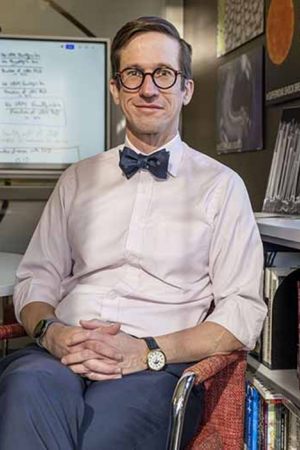

# Santiago Schnell

{width=300px align=left}

Adjunct Professor of [Molecular & Integrative Physiology](https://medicine.umich.edu/dept/molecular-integrative-physiology)  
**[University of Michigan](https://umich.edu/)**

Adjunct Professor of [Biological Sciences](https://biology.nd.edu/)  
**[University of Notre Dame](https://www.nd.edu/)**

[Google Scholar](https://scholar.google.com/citations?user=E6wiEloAAAAJ&hl=en) ·
[LinkedIn](https://www.linkedin.com/in/santiago-schnell) ·
[GitHub](https://github.com/santiago-schnell)  
[Curriculum Vitae (PDF)](assets/files/schnell-cv.pdf) ·
[Short Biography (PDF)](assets/files/schnell-short_bio.pdf)  
[Mathematical Genealogy Tree (PDF)](assets/files/math-genealogy.pdf)

Santiago is a mathematical biologist whose research lies at the interface of the life, physical, and 
computational sciences. His work focuses on understanding the molecular continuum between health and disease, 
with particular emphasis on enzyme kinetics, protein aggregation, and quantitative diagnostics. He is 
internationally recognized for developing the Schnell-Mendoza equation—a widely adopted method for 
estimating enzyme kinetic parameters—and for advancing mathematical models of the polymerase chain 
reaction (PCR), a cornerstone technique in molecular biology.

He earned his undergraduate degree in biology from Universidad Simón Bolívar in Venezuela and his 
doctorate in mathematics from the University of Oxford. At Oxford, he was a Junior Research Fellow 
at Christ Church and later a Senior Research Fellow of the Wellcome Trust at the Wolfson Centre 
for Mathematical Biology. He has held faculty positions at Indiana University; the University of 
Michigan, where he was named the John A. Jacquez Collegiate Professor of Physiology and served as Chair 
of the Department of Molecular & Integrative Physiology; the University of Notre Dame, where he served as 
the William K. Warren Foundation Dean of the College of Science and Professor of Biological Sciences and of 
Applied & Computational Mathematics & Statistics; and Dartmouth College, where he served as Provost and 
Professor of Mathematics.

He is currently on sabbatical and is Adjunct Professor of Molecular & Integrative Physiology at the 
University of Michigan and Adjunct Professor of Biological Sciences at the University of Notre Dame.

Dr. Schnell has received numerous honors for his research, including election to the American 
Academy of Sciences and Letters and the Arthur Winfree Prize. He is a Fellow of several learned 
societies, including the Royal Society of Chemistry, the Society for Mathematical Biology, and 
the American Association for the Advancement of Science. He has served as President of the Society 
for Mathematical Biology and on the editorial boards of leading scientific journals.

At the core of his scientific mission is the belief that accurate measurement and sound 
mathematical modeling are essential to deciphering the complexity of biological systems. His 
laboratory develops theoretical and computational tools to interpret experimental data rigorously, 
train the next generation of scientists, and contribute to a more quantitative understanding 
of physiology and disease.

## Contact

**Email:** [schnells@umich.edu](mailto:schnells@umich.edu)
