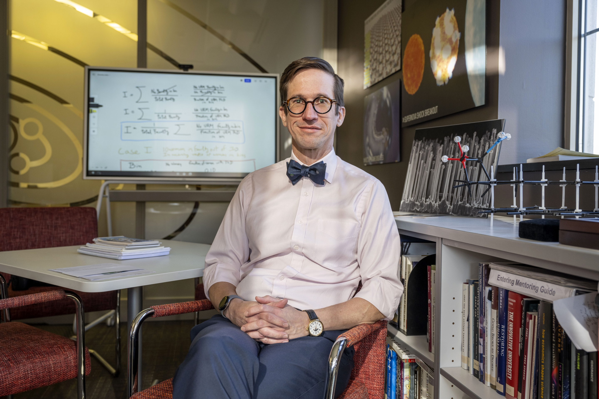
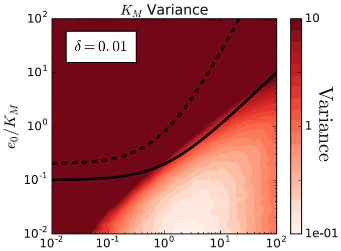
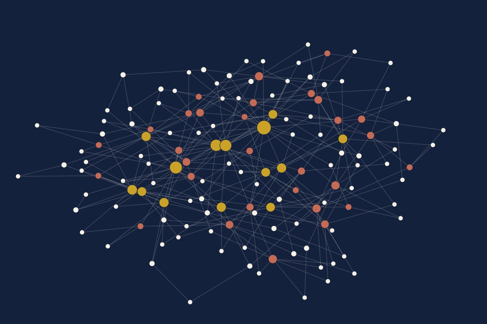
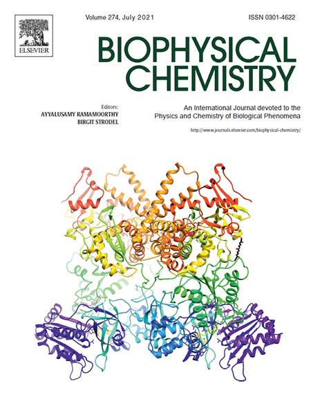
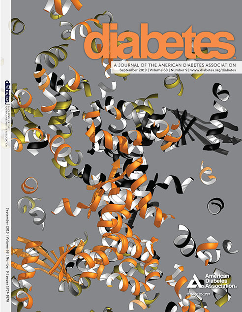
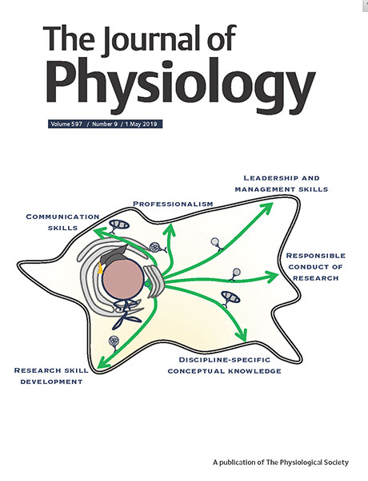

  

    
Mathematical biology · Measurement science · Higher education

    <h1 class="hero__title">Santiago Schnell</h1>
    
Accurate measurement and sound mathematical modeling are how we decipher
    the complexity of living systems.

    
Santiago Schnell is a mathematical biologist and Adjunct Professor at the
    University of Michigan and the University of Notre Dame. His research develops methods and models
    for rigorous, reproducible, and robust measurement in the biomedical sciences, working in partnership
    with experimental groups around the world.

    

      <a class="primary" href="about/">About Santiago</a>
      <a href="publications/">Publications</a>
      <a href="assets/files/schnell-cv.pdf">Curriculum vitae</a>
    

  

  <figure class="hero__portrait">
    
  </figure>

## Selected Projects

  
  

    
Mathematical Biology

    <h3 class="card-title">
      <a href="research/#kinetics">Principles of Enzyme and Biochemical Kinetics</a>
    </h3>
    
We derive rate equations and develop standards-based approaches to measure the physical constants of biochemical reactions.

  

  
  

    
Science of Science

    <h3 class="card-title">
      <a href="research/#universities">Measuring and Improving Research University Performance</a>
    </h3>
    
We develop metrics and models to measure and improve the performance of scientists, research universities, and academic policies.

  

[See our research program →](research.md)

## Team

  
  

    
Postdoctoral Fellow

    <h3 class="card-title"><a href="team/#svoboda">Jakub Svoboda</a></h3>
    
Jakub works on evolutionary dynamics on graphs, studying how population structure
    influences the spread of cooperative strategies. He is also investigating optimal
    decision-making in stochastic games on graphs.

  

  
  

    
Doctoral Candidate

    <h3 class="card-title"><a href="team/#gimon">Isabella Gimon</a></h3>
    
Isabella uses rule-based and agent-based models to investigate how macromolecular
    crowding and stochastic interactions shape protein aggregation, a process implicated
    in neurodegenerative disease.

  

[Meet the rest of the team →](team/index.md)

## Latest Cover Features

  

    
    
Biophysical Chemistry July 1, 2021

  

  

    
    
Diabetes September 1, 2019

  

  

    
    
The Journal of Physiology March 31, 2019

  

[See the rest of our cover features →](publications/covers.md)

---
## Latest Publications

J. R. Rohr, M. E. Pfrender, S. Schnell (2026). [When editors outnumber articles: Editorial board scaling in special issue and author pays publishing](). *Quantitative Science Studies*, in press.

S. Schnell (2026). [Academic freedom and Catholic mission: The procedural overlap zone in university governance](). *Journal of Catholic Higher Education*, in press.

S. Gilbert, S. Schmid, S. Schnell, J. Svoboda, M. X. Yeo (2026). Brief Announcement: [Liquid democracy under vote correlation: On the fallacies of averaging and the excluded middle](https://doi.org/10.4230/LIPIcs.DISC.2026.64). In *40th International Symposium on Distributed Computing (DISC 2026)*. Leibniz International Proceedings in Informatics (LIPIcs) **397**, 64:1–64:6. Schloss Dagstuhl – Leibniz-Zentrum für Informatik.

J. D. Calhoun, C. Wang, C. G. Biar, J. R. Gunti, J. S. Lee, A. M. Geller, J. H. Hong, S. Schnell, L. T. Dang, Y. Wang, J. M. Parent, L. L. Isom, M. D. Uhler, H. C. Mefford, M. E. Ross, V. Aguiar-Pulido, G. L. Carvill (2026). [Gene-specific machine learning model EpiPred identifies likely pathogenic variants in the epilepsy-related gene STXBP1](https://doi.org/10.1172/JCI207160). *Journal of Clinical Investigation* **136**, e207160.

S. Schnell (2026). [The stairs of reconciliation: A mathematical tourist in Graz.](https://doi.org/10.1007/s00283-026-10572-9) *The Mathematical Intelligencer*, DOI: 10.1007/s00283-026-10572-9.

S. Schnell (2026). [From signals to measurands: A measurement-science roadmap for reproducible analytical biochemistry.](https://doi.org/10.1021/acsmeasuresciau.6c00198) *ACS Measurement Science Au* **6**, 1365–1374. (perspective) [code](https://github.com/santiago-schnell/signals-to-measurands)

I. V. Gimón, C. Sandefur, S. Schnell (2026). [Reproducible agent-based simulations of protein aggregation: A FAIR implementation](https://doi.org/10.1007/s11538-026-01739-8). *Bulletin of Mathematical Biology* **88**, art. 181. [code](https://zenodo.org/records/15230587)

S. Schnell (2026). [Reaction acceleration: Reviving the second derivative in chemical kinetics](https://doi.org/10.1002/syst.70047). *ChemSystemsChem* **8**, e70047. [code](https://github.com/santiago-schnell/reaction-acceleration)

J. Eilertsen, S. Schnell, S. Walcher (2026). [Ehrlich occupancy time: Beyond $k_{\rm off}$ to a complete residence time framework](https://doi.org/10.1007/s10928-026-10049-4). *Journal of Pharmacokinetics and Pharmacodynamics* **53**, art. 46. [code](https://github.com/santiago-schnell/ehrlich-occupancy-time)

S. Pal, A. Mallela, L. Pracher, C. Wei, F. Fu, S. Schnell, M. A. Nowak (2026). [Large language models instantiate evolutionarily robust strategies of cooperation](https://doi.org/10.1093/pnasnexus/pgag210). *PNAS Nexus* **5**, pgag210. [data](https://doi.org/10.5281/zenodo.18148156) [code](https://github.com/Saptarshi07/LLM-strategy)

H. V. Westerhoff, B. M. Bakker, A. S. Bommarius, M. L. Cárdenas, A. Cornish-Bowden, P. Fitzpatrick, P. Halling, V. Hatzimanikatis, C. Kettner, Y. Liu, A. G. McDonald, E. Noor, J. Pleiss, F. Raushel, J. Rohwer, S. Schnell, K. F. Tipton, M.-D. Tsai, U. von Stockar, U. Wittig, R. Wohlgemuth, J. M. Woodley (2026). [Metabolic thermodynamics: Pertinent reference state and energy potentials](https://doi.org/10.1111/febs.70415) *FEBS Journal* **293**, 3111-3126.

S. Marques, J. Planas-Iglesias, J. Velecký, M. Musil, Y. Asano, T. Borowski, V. Brissos, M. Cespugli, K. Chorozian, M. Dadashipour, E. Erdem, E. Ferrandi, K. Grigorakis, A. Kluza, J. Lawniczek, K. Makryniotis, D. Monti, B. Nestl, A. Ngo, E. Nikolaivits, S. Patti, C. Pentari, C. Ferro Rodrigues, T. Schopper, K. Seweryn-Ożóg, M. Szaleniec, A. Taborda, M. Tataruch, D. Tischler, E. Topakas, J. Wang, P. Wójcik, A. Wojtkiewicz, J. Woodley, O. Zastawny, L. Martins, M. Fraaije, J. Pleiss, S. Schnell, J. Damborský, S. Mazurenko, D. Bednar (2026). [Mobilizing the biocatalysis community for reproducible and reusable data collection](https://doi.org/10.1021/acscatal.5c07904). *ACS Catalysis* **16**, 8858–8868.

A. Mallela, S. Schnell (2026). [Structural hormesis in protein aggregation: A minimal mechanistic model](https://doi.org/10.1098/rsif.2025.1037) *Journal of the Royal Society Interface* **23**, 20251037. [code](https://github.com/santiago-schnell/Structural-Hormesis-in-Protein-Aggregation)

I. V. Gimón, C. Sandefur, S. Schnell (2026). [Macromolecular crowding and protein aggregation: Friend, foe or contextual force](https://doi.org/10.1016/j.pbiomolbio.2025.12.001). *Progress in Biophysics and Molecular Biology* **199**, 79-98. (review)

I. V. Gimón, C. Sandefur, S. Schnell (2025). [The hidden influences of macromolecular crowding: A new frontier in cellular biology and medicine](https://doi.org/10.1007/978-3-032-03370-3_23). In: Uversky, V.N. (eds) [(Macro)Molecular Crowding. Subcellular Biochemistry](https://doi.org/10.1007/978-3-032-03370-3), vol 109. Springer, Cham. (review)

S. Schnell, D. L. Gumucio (2025). [Medicine and The Arts: Commentary on Thistle](https://doi.org/10.1097/01.ACM.0001168124.85382.a4). *Academic Medicine* **100**, 1153. (see the image, [Thistle by Maria Morrell, PhD](https://doi.org/10.1097/ACM.0000000000006035))

K. Srivastava, J. Eilertsen, V. Booth, S. Schnell (2025). [Accuracy versus Predominance: Reassessing the validity of the quasi-steady-state approximation](https://doi.org/10.1007/s11538-025-01451-z). *Bulletin of Mathematical Biology* **87**, 73.

S. Schnell, P. K. Maini (2024). [In Memory of Edmund John Crampin: Multi-scale and multi-physics phenomena in biology.](https://doi.org/10.1016/j.mbs.2024.109283). *Mathematical Biosciences* **376**, 109283. (editorial)

J. Eilertsen, S. Schnell, S. Walcher (2024). [The Michaelis-Menten reaction at low substrate concentrations: Pseudo-first-order kinetics and conditions for timescale separation](https://doi.org/10.1007/s11538-024-01295-z). *Bulletin of Mathematical Biology* **86**, 68.

M. S. DeNies, Allen P. Liu, S. Schnell (2024). [Seeing beyond the blot: A critical look at assumptions and raw data interpretation in Western blotting](https://www.degruyter.com/document/doi/10.1515/bmc-2022-0047). *Biomolecular Concepts* **15**, 20220047.

J. Eilertsen, S. Schnell, S. Walcher (2024). [The unreasonable effectiveness of the total quasi-steady state approximation, and its limitations](https://doi.org/10.1016/j.jtbi.2024.111770). *Journal of Theoretical Biology* **583**, 111770.

J. Eilertsen, S. Schnell, S. Walcher (2024). [Rigorous estimates for the quasi-steady state approximation of the Michaelis-Menten reaction mechanism at low enzyme concentrations](https://doi.org/10.1016/j.nonrwa.2024.104088). *Nonlinear Analysis: Real World Applications* **120**, e2219683120.

K. Ikami, S. Shoffner-Beck, M. Tyczynska Weh, S. Schnell, S. Yoshida, E. A. Diaz Miranda, S. Ko, L. Lei (2023). [Branched germline cysts and female-specific cyst fragmentation facilitate oocyte determination in mice](https://doi.org/10.1073/pnas.2219683120). *Proceedings of the National Academy of Sciences of the United States of America* **120**, e2219683120.

J. Eilertsen, S. Schnell, S. Walcher (2023). [Natural parameter conditions for singular perturbations of chemical and biochemical reaction networks](https://doi.org/10.1007/s11538-023-01150-7). *Bulletin of Mathematical Biology* **85**, 48.

M. A. Gingerich, J. Zhu, B. Chai, M. P. Vincent, N. Xie, V. Sidarala, N. A. Kotov, D. Sahu. D. J. Klionsky, S. Schnell, S. A. Soleimanpour (2023). [Reciprocal regulatory balance within the CLEC16A-RNF41 mitophagy complex depends on an intrinsically disordered protein region](https://doi.org/10.1016/j.jbc.2023.103057). *Journal of Biological Chemistry* **299**, 103057.

[See all our publications →](publications/index.md)
