# Our Team

Our team, led by Santiago Schnell, brings together scientists, trainees, and staff with diverse backgrounds who share 
a common commitment to addressing complex biological and biomedical problems through quantitative and interdisciplinary 
approaches.

We foster a collaborative and intellectually vibrant research environment where mathematical modeling, 
computational methods, and scientific rigor are integrated with experimental insight. Our work spans 
enzymology, quantitative biology, and the science of science, advancing discovery and understanding 
across disciplines.

!!! info "Now Recruiting"
    We welcome inquiries from postdoctoral fellows and established scientists who would like to join
    our interdisciplinary research team. [Learn more!](joining.md)

---

## Postdoctoral Fellows

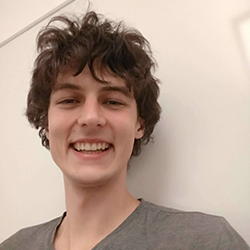{width=300px align=left}
### Jakub Svoboda
**Postdoctoral Research Scientist**  
[Department of Mathematics](https://math.dartmouth.edu/)  
**[Dartmouth College](https://www.dartmouth.edu)**  
Mathematical Olympiad Silver Medalist and ACM ICPC Competitor  
[Old Website](https://pub.ista.ac.at/~jsvoboda/my-webpages/) ·
[Email](mailto:Jakub.Svoboda@dartmouth.edu) ·
[Google Scholar](https://scholar.google.com/citations?user=GgwnWfEAAAAJ&hl=cs) ·
[LinkedIn](https://www.linkedin.com/in/jakub-svoboda-882335154/)

Jakub received his BSc and MSc in Computer Science with honors from the
[Faculty of Mathematics and Physics](https://www.mff.cuni.cz/en) at
[Charles University in Prague](https://www.cuni.cz/), and his PhD
from the [Institute of Science and Technology Austria (ISTA)](https://ist.ac.at/),
where he was advised by
[Krishnendu Chatterjee](https://ist.ac.at/en/research/chatterjee-group/).
Prior to joining the group, he briefly held a postdoctoral fellowship at ISTA.

His research focuses on evolutionary dynamics on graphs and stochastic
processes governing the spread of genetic variants and behavioral strategies
across structured populations. His work on density amplifiers of cooperation
for spatial games was published in *Proceedings of the National Academy of 
Sciences*, and he received the Best Paper Award at International Colloquium 
On Structural Information and Communication Complexity 2023. He is also 
investigating games on graphs, including optimal strategies in stochastic 
and concurrent game settings.

---

## Graduate Students

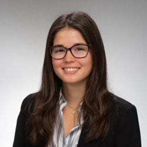{width=300px align=left}
### Isabella Gimon
**Doctoral Candidate**  
[Integrated Biomedical Sciences Graduate Program](https://ibms.nd.edu/)  
**[University of Notre Dame](https://www.nd.edu)**  
[Email](mailto:igimon@nd.edu) 

Isabella earned her BS in Biology & Applied Sciences with minors in Computer Science & Chemistry
from [Florida International University](https://www.fiu.edu/) in 2021. She is the recipient of the 
[NSF Graduate Fellowship](https://www.nsf.gov/funding/opportunities/grfp-nsf-graduate-research-fellowship-program). 

Her research employs rule-based and agent-based modeling to investigate the mechanisms of protein aggregation, 
a process implicated in neurodegenerative diseases such as Huntington’s and Alzheimer’s. She uses formal 
rule-based representations to construct and simulate the chemical kinetics of protein aggregation networks, 
capturing both conformational and oligomeric pathways. These approaches enable mechanistic insight into 
how molecular crowding and stochastic interactions shape pathological outcomes in complex intracellular 
environments.

---

## Collaborators

Our group maintains active collaborations with a global network of scientists working at the forefront 
of mathematical biology, biochemical kinetics, data standards, and scientometrics. These partnerships 
enrich our research through complementary expertise, joint publications, co-supervision of trainees, 
and shared commitments to open science, reproducibility, and innovation.

We are proud to collaborate with the following colleagues:

  

    <a href="https://scholar.google.com/citations?user=eyOmVt4AAAAJ&hl=en">
    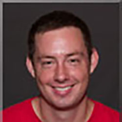</a>
    
Justin Eilertsen Mathematical Reviews USA

  

  

    <a href="https://dormantbiologylab.org/">
    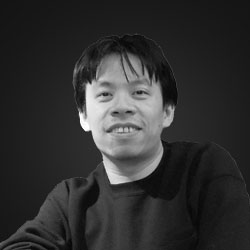</a>
    
Chi-Kuo Hu Stony Brook University USA

  

  

    <a href="https://medicine.missouri.edu/centers-institutes-labs/lei-lab">
    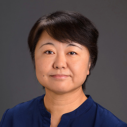</a>
    
Lei Lei University of Missouri USA

  

  

    <a href="https://people.maths.ox.ac.uk/maini/">
    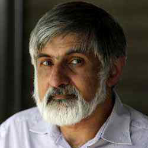</a>
    
Philip K. Maini University of Oxford UK

  

 <!-- 
 -->
 <!--   <a href="https://sites.harvard.edu/martin-nowak/"> -->
 <!--   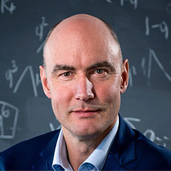</a> -->
 <!--   
Martin Nowak Harvard University USA
 -->
 <!-- 
 -->

  

    <a href="https://www.ibc.uni-stuttgart.de/en/institute/team/Pleiss-00003/">
    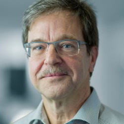</a>
    
Jürgen Pleiss University of Stuttgart Germany

  

  

    <a href="https://philpeople.org/profiles/vanessa-seifert">
    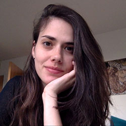</a>
    
Vanessa Seifert University 
    of Athens Greece

  

  

    <a href="http://www.matha.rwth-aachen.de/en/mitarbeiter/walcher/">
    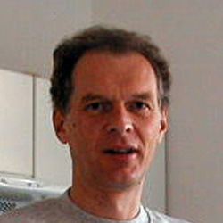</a>
    
Sebastian Walcher RWTH Aachen Germany

  

  

    <a href="https://doi.org/10.1113/JP277684">
    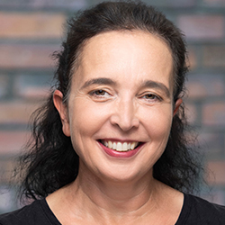</a>
    
Ulrike Wittig HITS gGmbH Germany

  

